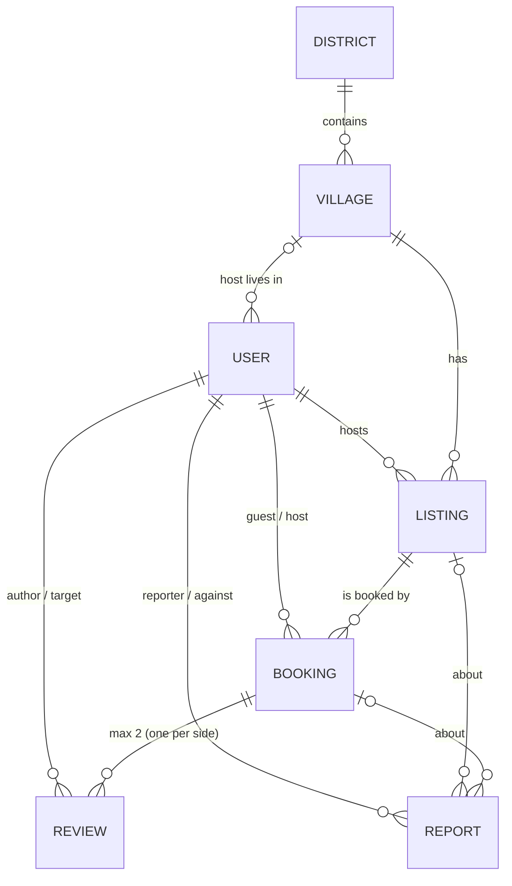
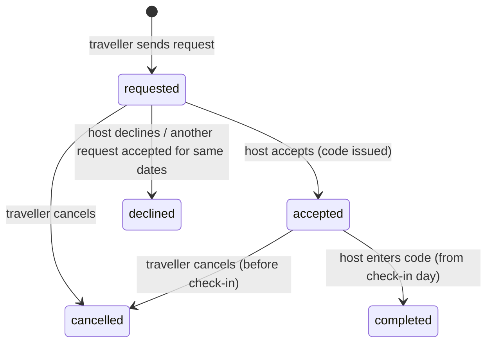

# Otithi: How It's Built

This document explains how Otithi works inside: the technology, how the parts connect, the database, and how each feature is built from screen to API to database. For how to run the app, see `README.md`. For the original plan, see `IMPLEMENTATION_PLAN.md`.

---

## 1. Tech stack

Otithi is a **MERN** app (MongoDB, Express, React, Node.js). It runs fully offline on one laptop with no cloud services.

| Layer | Technology | What it's used for |
|---|---|---|
| Frontend framework | **React 18** | All screens, built as components |
| Build tool / dev server | **Vite 5** | Fast dev server on port 5173; forwards `/api` and `/uploads` to the backend |
| Routing | **React Router 6** | Page URLs (`/browse`, `/listing/:id`, `/host` …) and role-protected areas |
| Styling | **Tailwind CSS 3** | Utility classes; brand colours set in `client/tailwind.config.js` |
| Icons | **lucide-react** | Checklist and UI icons |
| Fonts | **@fontsource** (Hind Siliguri, Bricolage Grotesque) | Bundled into the app so they work without internet. Hind Siliguri supports Bangla |
| HTTP client | **axios** | API calls; adds the login token to every request automatically |
| Backend runtime | **Node.js 20+** | Runs the API server |
| Web framework | **Express 5** | REST API on port 5050 |
| Database | **MongoDB Community Server** (local) | Stores all data in the `otithi` database |
| ODM | **Mongoose 9** | Schemas, validation, relations (`ref` + `populate`), aggregations |
| Login | **jsonwebtoken (JWT)** | Signed login tokens, valid for 7 days |
| Password hashing | **bcryptjs** | Passwords are stored hashed (10 salt rounds), never in plain text |
| File uploads | **multer** | ID photos and room photos saved to disk (JPG/PNG/WEBP, max 5 MB) |
| Config | **dotenv** | Reads `PORT`, `MONGO_URI` and `JWT_SECRET` from `server/.env` |
| Dev tools | **nodemon**, **concurrently** | Restart the API on file changes; `npm run dev` starts both servers at once |

**Deliberately left out:** payment gateway (guests pay the host in cash), email/SMS, maps API. Leaving these out keeps the app fully offline and free to run.

---

## 2. Architecture

```
┌───────────────────────────── Browser ─────────────────────────────┐
│  React app (Vite, :5173)                                          │
│  Pages ──► useApi hook / axios ──► adds "Authorization: Bearer"   │
│  AuthContext (token in localStorage)   ProtectedRoute (by role)   │
└──────────────────────────────┬────────────────────────────────────┘
                               │  /api/*  and  /uploads/*
                               │  (Vite dev proxy)
┌──────────────────────────────▼────────────────────────────────────┐
│  Express API (Node, :5050)                                        │
│  routes/ ──► middleware (protect, requireRole, requireApproved,   │
│              multer upload) ──► controllers/ (business rules)     │
│  Central error handler → JSON { message }                         │
└───────────────┬──────────────────────────────────┬────────────────┘
                │ Mongoose                         │ fs
┌───────────────▼──────────────┐   ┌───────────────▼────────────────┐
│  MongoDB (local, :27017)     │   │  Disk                           │
│  database "otithi"           │   │  server/uploads/      (public)  │
│  7 collections               │   │  server/private/ids/  (private) │
└──────────────────────────────┘   └─────────────────────────────────┘
```

### The life of one request

Example: a host accepts a booking.

1. **Page:** `client/src/pages/host/Dashboard.jsx` calls `api.put('/bookings/<id>/accept')`.
2. **axios:** `client/src/api/axios.js` reads `otithi_token` from `localStorage` and adds the `Authorization: Bearer <token>` header.
3. **Vite proxy:** `client/vite.config.js` forwards `/api/...` to `http://localhost:5050`.
4. **Route:** `server/routes/bookings.js` matches `PUT /:id/accept` and runs `protect`, then `requireRole('host')`.
5. **Middleware:** `server/middleware/auth.js` checks the JWT, loads the user from MongoDB, and puts it on `req.user`.
6. **Controller:** `acceptBooking` in `server/controllers/bookingController.js` checks the rules (the host owns the booking, it's still `requested`, the dates are free), generates the code, saves it, and declines overlapping requests.
7. **Response:** JSON goes back to the page, which reloads its data. Any error comes back as `{ message }` with a 4xx status, and the page shows that message.

### Folder structure

```
otithi/
├── package.json              # root: "npm run dev" starts both servers (concurrently)
├── client/                   # React frontend
│   ├── vite.config.js        # dev proxy /api and /uploads → :5050
│   ├── tailwind.config.js    # brand colours, fonts, radius
│   └── src/
│       ├── main.jsx          # BrowserRouter + AuthProvider
│       ├── App.jsx           # all routes and role-protected groups
│       ├── api/axios.js      # axios instance + JWT header
│       ├── context/AuthContext.jsx   # login, register, logout, restore session
│       ├── hooks/useApi.js   # GET helper: { data, loading, error, reload }
│       ├── lib/              # booking.js (dates, statuses), listing.js (checklist labels)
│       ├── components/       # Navbar, RoomCard, HostCalendar, ReviewForm, ReportDialog …
│       └── pages/            # Home, Browse, Village, Listing, Booking, BookingDetail, Auth
│           ├── traveller/Dashboard.jsx
│           ├── host/Dashboard.jsx, host/AddRoom.jsx
│           └── admin/Dashboard.jsx, ReportsSection.jsx, LocationsSection.jsx
└── server/                   # Express backend
    ├── server.js             # app setup, route mounting, error handler
    ├── config/db.js          # MongoDB connection
    ├── middleware/auth.js    # protect, optionalAuth, requireRole, requireApproved
    ├── middleware/upload.js  # multer: private ID uploads, public room photos
    ├── models/               # 7 Mongoose schemas
    ├── routes/               # one file per area (auth, listings, bookings …)
    ├── controllers/          # the logic behind each route
    ├── seed.js               # demo data (wipes the database first)
    ├── uploads/              # room photos (served at /uploads)
    └── private/ids/          # ID documents (never served publicly)
```

The backend uses a **routes → middleware → controllers → models** pattern. Routes only say *who* can call *what*. Controllers hold the business rules. Models hold the data shape and validation.

---

## 3. Database

MongoDB database `otithi` with **7 collections**. Every document gets `createdAt` and `updatedAt` automatically (`timestamps: true`).

### Relationships



### Collections

**`users`** (`server/models/User.js`)
| Field | Type | Notes |
|---|---|---|
| `name`, `phone` | String | required |
| `email` | String | required, **unique**, stored lowercase |
| `password` | String | bcrypt hash; `select: false`, so it's never returned unless asked for |
| `role` | `traveller` \| `host` \| `admin` | |
| `idDocument` | String | file name in `server/private/ids/`; removed from every JSON response |
| `status` | `pending` \| `approved` \| `rejected` | new accounts start as `pending` |
| `village` | → Village | hosts only |

**`districts`**: `name` (unique).

**`villages`**: `name`, `district` (→ District), `area`, `nearestBazar`, `landmark`, `photo`. The pair (`name`, `district`) is unique.

**`listings`** (one room or house, `server/models/Listing.js`)
| Field | Type | Notes |
|---|---|---|
| `host` → User, `village` → Village | ObjectId | |
| `title`, `description`, `beds` | String | |
| `pricePerNight`, `capacity`, `rooms` | Number | validated ≥ 1 |
| `meals` | Boolean | home-cooked meals on request |
| `photos` | [String] | `/uploads/<file>` paths |
| `checklist` | sub-document | the **Honest Room Condition Checklist**: 6 required answers, each an enum (see §4.3) |
| `safety` | sub-document | 5 booleans: `familyOnSite`, `femaleMembersPresent`, `separateEntrance`, `soloFemaleOk`, `childrenOk` |
| `directions` | String | exact directions, **hidden until a booking is accepted** |
| `nearestLandmark`, `nearestBazar` | String | shown publicly |
| `houseRules` | [String] | |
| `blockedDates` | [Date] | days the host marked unavailable |
| `status` | `pending` \| `approved` \| `rejected` | only `approved` rooms are public |

**`bookings`** (`server/models/Booking.js`)
| Field | Type | Notes |
|---|---|---|
| `listing`, `guest`, `host` | → Listing, User, User | `host` is copied in so host queries are quick |
| `checkIn`, `checkOut` | Date | stored as UTC midnight of the chosen day |
| `nights`, `guests`, `totalPrice` | Number | `totalPrice = nights × pricePerNight`, paid in cash |
| `message` | String | max 1000 characters |
| `status` | `requested` \| `accepted` \| `declined` \| `cancelled` \| `completed` | |
| `code` | String | e.g. `OT-7K2Q`, set when the host accepts |
| `acceptedAt`, `completedAt`, `cancelledAt` | Date | |

**`reviews`**: `booking`, `listing`, `author`, `target` (refs); `type` (`guest_to_host` \| `host_to_guest`); `rating` (1–5); `comment`; `checklistAccurate` (`yes` \| `mostly` \| `no`, guest reviews only).

**`reports`**: `reporter`, `against` (→ User); `booking` or `listing` (whichever the report is about); `type`; `title`; `details`; `status` (`open` \| `resolved`); `resolvedAt`.

### Indexes

| Collection | Index | Why |
|---|---|---|
| users | `email` unique | one account per email |
| districts | `name` unique | no duplicate districts |
| villages | `{ name, district }` unique | the same village name can exist in different districts |
| listings | `{ status, village }` | browse and village pages filter on these |
| bookings | `code` unique, sparse | codes never repeat; bookings without a code are skipped |
| bookings | `{ listing, status, checkIn }` | the double-booking overlap check |
| reviews | `{ booking, type }` unique | **one review per side per stay**, enforced by the database |
| reviews | `{ listing, type }`, `{ target, type }` | room ratings and guest ratings |

### Why MongoDB

- It was part of the approved MERN proposal.
- It runs fully locally, and MongoDB Compass gives a visual view of the data for the demo.
- The checklist and safety answers fit naturally as **embedded sub-documents** inside a listing, so there's no need for extra join tables.
- Aggregation pipelines calculate the stats (ratings, village counts, income) directly in the database.

---

## 4. Features, one by one

Each feature lists its **screen**, **API**, **data**, and **how it works**.

### 4.1 Accounts, login and ID verification

- **Screen:** `pages/Auth.jsx` (login and sign-up), `components/VerificationBanner.jsx`
- **API:** `POST /api/auth/register`, `POST /api/auth/login`, `GET /api/auth/me`
- **Data:** `users`

**How it works**
1. On sign-up the user chooses *traveller* or *host* and uploads a photo of their ID. The form is sent as `multipart/form-data`.
2. `uploadId` (multer) saves the photo to `server/private/ids/` with a random file name. This folder is **not** served by `express.static`, so nobody can open the file by URL.
3. The `User` model's `pre('save')` hook hashes the password with bcrypt.
4. The server returns a **JWT** (`{ id }`, signed with `JWT_SECRET`, valid 7 days). The client stores it in `localStorage` as `otithi_token`.
5. The new account is `pending`. It can log in, but `requireApproved` middleware blocks booking and adding rooms until an admin approves the ID. A banner explains this.
6. When the page reloads, `AuthContext` calls `/auth/me` to restore the session.

**Role protection, in two layers**
- *Frontend:* `ProtectedRoute` sends users to `/login`, or to their own dashboard if they have the wrong role. This is only for convenience.
- *Backend:* `protect` + `requireRole(...)` + `requireApproved` on every route. This is the real security.

### 4.2 Locations (districts and villages)

- **Screens:** Home, Browse, `pages/admin/LocationsSection.jsx`
- **API:** `GET /api/districts`, `GET /api/villages?district=`, `GET /api/villages/:id`; admin `POST`/`DELETE /api/admin/districts|villages`
- **Data:** `districts`, `villages`

**How it works**
- Village cards show *households, rooms, capacity and starting price*. These are not stored. They're calculated live with an aggregation over approved listings (`villageStats` in `locationController.js`): group by village → count unique hosts, add up rooms and capacity, take the minimum price.
- The admin can add districts and villages. A district can only be deleted if it has no villages, and a village only if it has no rooms, so nothing is left pointing at a deleted record.
- Duplicate district names are checked case-insensitively (MongoDB collation with `strength: 2`).

### 4.3 Rooms and the Honest Room Condition Checklist

- **Screen:** `pages/host/AddRoom.jsx`, a 4-step wizard: *Room details → Photos → Condition checklist → Directions & safety*
- **API:** `POST /api/listings` (multipart, up to 10 photos), `PUT /api/listings/:id`, `GET /api/listings/mine`
- **Data:** `listings`

**The checklist** answers six fixed questions, each with a fixed set of answers:

| Question | Allowed answers |
|---|---|
| Toilet | attached · outside · shared |
| Electricity | steady · loadshedding · solar |
| Water | tap · tubewell · pond |
| Mobile network | good · weak · none |
| Bedding | provided · bring_own |
| Road access | vehicle · short_walk · long_walk |

**How it works**
- The six questions are defined **once** as `CHECKLIST` in `server/models/Listing.js`. The Mongoose schema is generated from that object, so every answer is required and must be one of the allowed values. The frontend copy in `client/src/lib/listing.js` adds labels, icons and colour tones (good / warn / none).
- Because the answers are fixed values instead of free text, travellers can **filter** on them and rooms can be compared fairly.
- Photos go to `server/uploads/` and are served publicly at `/uploads/<file>`.
- Every new room starts as `pending`. **Editing a room sends it back to `pending`**, so the admin re-checks any changed checklist answers. *(The edit API exists, but there's no edit screen yet.)*
- If saving fails, the uploaded photos are deleted so no orphan files are left behind.

### 4.4 Browse and search

- **Screen:** `pages/Browse.jsx` (with *By village* and *By room* views)
- **API:** `GET /api/listings?district=&village=&minPrice=&maxPrice=&guests=&checkIn=&checkOut=&toilet=&road=&soloFemaleOk=true…`

**How it works**
- All filters are kept **in the URL** (`useSearchParams`), so a search can be shared, bookmarked, or restored with the Back button.
- The server builds one MongoDB query: `status: 'approved'` + price range + `checklist.<key>: { $in: [...] }` + `safety.<key>: true`.
- Rooms the host has blocked during the chosen dates are hidden with `blockedDates: { $not: { $elemMatch: { $gte: from, $lt: to } } }`.
- `directions` and `blockedDates` are left out of search results (`.select('-directions -blockedDates')`).
- Each room gets a `fitsGroup` flag instead of being hidden, because a large group can split across houses (§4.6).

### 4.5 Room page and saved rooms

- **Screen:** `pages/Listing.jsx`, `components/RoomCard.jsx`
- **API:** `GET /api/listings/:id`, `GET /api/reviews/listing/:id`

**How it works**
- Shows the photos, the checklist as coloured chips, the safety badges, the house rules, the nearest landmark and bazar, and reviews.
- A non-approved room returns 404, except to its owner or the admin (`optionalAuth` checks who is viewing).
- **Exact directions are removed** from the response unless the viewer is the owner or the admin.
- **Saved rooms** (heart button) are stored in the browser's `localStorage` under `otithi_saved`, not in the database. This is a known limitation.

### 4.6 Village page and group planner

- **Screen:** `pages/Village.jsx`
- **API:** `GET /api/villages/:id`, then one `POST /api/bookings` per house

**How it works**
- The traveller ticks several houses in one village, enters dates and a group size, and presses *Send booking requests*.
- `allocate()` sorts the chosen houses by capacity (largest first) and fills each one in turn. For example, 7 guests across houses that sleep 4 and 4 become requests for **4 + 3**.
- The requests are sent in parallel with `Promise.allSettled`, so one house refusing doesn't stop the others. Each result is shown separately ("Request sent" or the error).

### 4.7 Booking flow

- **Screens:** `pages/Booking.jsx` (request form), `pages/BookingDetail.jsx`, the traveller and host dashboards
- **API:** `POST /api/bookings`, `GET /api/bookings/mine`, `GET /api/bookings/host`, `GET /api/bookings/:id`, `PUT /api/bookings/:id/accept|decline|cancel|complete`
- **Data:** `bookings`

**Status lifecycle**



**Rules checked when a request is sent** (`createBooking`)
- The traveller is logged in, has the `traveller` role, and is **approved**.
- The room exists and is `approved`.
- Check-in isn't in the past (by **Bangladesh time, UTC+6**). The stay is 1–30 nights.
- The number of guests is between 1 and the room's capacity.
- **No overlap** with an accepted booking or a blocked date.
- No duplicate: the same traveller can't have two open requests for the same room and overlapping dates.
- `totalPrice` is calculated on the server (`nights × pricePerNight`), so the client can't change it.

**Preventing double bookings**
Two date ranges overlap when `existing.checkIn < new.checkOut AND existing.checkOut > new.checkIn`. `datesTaken()` runs this check against **accepted** bookings and the room's `blockedDates`. It runs **twice**: once when the request is sent, and again when the host accepts, because the dates may have been taken in between. When the host accepts, every other `requested` booking that overlaps is **declined automatically** with one `updateMany`.

**The booking code**
- When the host accepts, `newCode()` generates `OT-` + 4 random characters from `crypto.randomBytes`. The character set has no `0/O` or `1/I`, so the code is easy to read out over the phone. A unique index guarantees no two bookings share a code.
- At the house, the guest shows the code and pays cash. The host enters it to mark the stay **completed**. This is allowed from the check-in day. The input is forgiving: `ot7k2q`, `7K2Q` and `OT-7K2Q` all match.

**Privacy unlocking**
`withPrivateDetails()` removes the room's **exact directions** and the **host's phone number** unless the booking is `accepted` or `completed`. In the same way, the host only sees the **guest's phone** after accepting. Before that, both sides see only the village, the landmark and the bazar.

**Guest history for hosts**
`GET /api/bookings/host` adds each guest's track record to the response: an aggregation counts the guest's completed stays and how many different hosts they stayed with, plus the guest's average rating and the latest comment from hosts. This helps the host decide whether to accept.

### 4.8 Host availability calendar

- **Screen:** `components/HostCalendar.jsx` (on the host dashboard)
- **API:** `PUT /api/listings/:id/blocked-dates { dates: ['2026-12-16', …] }`

**How it works**
A month view for one room. Days are coloured as *booked* (green), *requested* (mustard), *blocked* (crossed out), *free*, or *past*. Tapping a free day blocks it, and tapping a blocked day frees it. The whole list is saved at once. The server keeps only valid `YYYY-MM-DD` dates, removes duplicates, and sorts them. Blocked dates are used in both search (§4.4) and the overlap check (§4.7).

### 4.9 Reviews (two-way)

- **Screen:** `components/ReviewForm.jsx` (on the booking pages and the host dashboard), `components/Stars.jsx`
- **API:** `POST /api/reviews`, `GET /api/reviews/listing/:id`, `GET /api/reviews/guest/:id` (hosts and admin only)
- **Data:** `reviews`

**How it works**
- A review can only be written after the stay is **completed**, and only by that booking's guest or host. The server decides the `type` (`guest_to_host` or `host_to_guest`) from who is logged in.
- The guest must also answer **"Was the condition checklist accurate?"** (yes / mostly / no). This keeps hosts honest about the checklist.
- **One review per side per stay** is enforced twice: by a check in the code and by the unique `{ booking, type }` index.
- Room ratings are calculated by an aggregation (`listingRatings`): average stars, review count, and the **% of guests who said the checklist was accurate**. These appear on room cards and the room page.

### 4.10 Reports

- **Screen:** `components/ReportDialog.jsx` (on the room page, the booking page and the host's history), `pages/admin/ReportsSection.jsx`
- **API:** `POST /api/reports`, admin `GET /api/admin/reports`, `PUT /api/admin/reports/:id/resolve`
- **Data:** `reports`

**How it works**
- **From a booking:** the server works out who is reporting whom. A guest reports the host; a host reports the guest. Only people in that booking can report it.
- **From a room page:** reports the room's host. A host can't report their own room.
- The admin sees all open reports, with names, the booking code and the room, and marks each one as resolved.

### 4.11 Admin panel

- **Screen:** `pages/admin/Dashboard.jsx` + `ReportsSection.jsx` + `LocationsSection.jsx`
- **API:** everything under `/api/admin/*`. The whole router is protected once with `router.use(protect, requireRole('admin'))`.

| Part | What it does |
|---|---|
| Stats cards | 11 counts fetched in parallel (`Promise.all`): verified hosts and travellers, pending users and rooms, live rooms, districts, villages, completed and upcoming bookings, **income to families** (sum of `totalPrice` over completed bookings), open reports |
| User verification | List pending users and **view their ID photo** through `GET /api/admin/users/:id/id-document`, the only way to reach the private file. Approve or reject |
| Room approval | Publish or reject pending rooms. A room **can't be published until its host is verified** |
| Reports | §4.10 |
| Locations | §4.2 |

### 4.12 Dashboards

- **Traveller** (`pages/traveller/Dashboard.jsx`): booking tabs (*Upcoming*, sorted soonest first, plus history tabs sorted newest first) and saved rooms.
- **Host** (`pages/host/Dashboard.jsx`): incoming requests with each guest's history, accept/decline, mark completed by code, the availability calendar, "My rooms" with their status, and stats (nights hosted, total earned in cash).

---

## 5. Security and privacy summary

| Concern | How it's handled |
|---|---|
| Passwords | bcrypt hash; `select: false`; removed in `toJSON` |
| Login | JWT signed with `JWT_SECRET`, expires after 7 days; checked on every protected request |
| Who can do what | `protect` → `requireRole` → `requireApproved` middleware on the server |
| Ownership | Controllers always filter by the logged-in user (`{ _id, host: req.user._id }`), so a user can't act on someone else's room or booking |
| ID documents | Stored outside the public folder; only reachable through an admin-only route |
| Directions and phone numbers | Removed from API responses until a booking is accepted |
| Uploads | Only JPG/PNG/WEBP, max 5 MB, random file names; files are deleted if the request fails |
| Bad input | Mongoose validation + checks in controllers; invalid ObjectIds return 404 instead of crashing |
| Errors | One central handler returns clean `{ message }` JSON; unexpected errors are logged and shown as "Server error" |
| Prices | Calculated on the server, never trusted from the client |

---

## 6. Dates and time zone

- Booking days are stored as **UTC midnight** of the chosen date (`2026-12-12T00:00:00Z`), so a date never shifts by a day between computers.
- "Today" for the booking rules (no past check-ins, cancel before the stay, complete from check-in day) is the **calendar day in Bangladesh (UTC+6)**, because the platform is Bangladesh-only. The server (`todayBD` in `bookingController.js`) and the client (`todayBD` in `lib/booking.js`) use the same rule.
- The client always formats booking dates with `timeZone: 'UTC'` so they display as the day that was chosen.

---

## 7. How it was built (phases)

| Phase | Commit | What was added |
|---|---|---|
| 1 · Setup | `b2ad6c0` | Vite + React + Tailwind client, Express + Mongoose server, local MongoDB connection, `/api/health`, shared components, `npm run dev` |
| 2 · Accounts | `b346946` | User model, register with ID upload, login, JWT and role middleware, AuthContext, ProtectedRoute, seed script |
| 3 · Rooms | `b346946` | District, Village and Listing models; add-room wizard; browse with filters; village and room pages; admin approval of users and rooms |
| 4 · Booking | `4710e55` | Booking model and rules, accept/decline/cancel/complete, booking code, auto-decline, availability calendar, group planner |
| 5 · Trust | `5487084` | Two-way reviews with the checklist-accuracy question, reports, location management, admin stats |
| 6 · Polish | `c9e0270` | Phone layouts, Bangladesh time zone fix, port 5050, realistic seed data, full browser test, README and screenshots |

### Development setup

- `npm run dev` (root) uses **concurrently** to start `nodemon server.js` (API, restarts on changes) and `vite` (web, hot reload) together.
- The Vite proxy means the frontend always calls relative URLs (`/api/...`). This avoids CORS issues in development.
- `npm --prefix server run seed` **wipes** the database and loads demo data: 1 admin, 4 districts, 9 villages, 3 travellers, 9 hosts, 9 rooms, 8 bookings, 5 reviews and 2 reports. Users are created with `User.create` (not `insertMany`) so the password-hashing hook runs.
