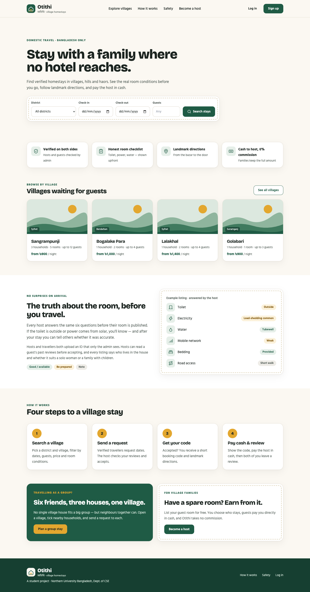

# Otithi (অতিথি)

**A homestay platform for remote-area tourism in Bangladesh.**

Travellers find verified family homestays in villages, hills and haors. Before they go, they see the real room conditions and landmark directions, and they pay the host in cash. Village families list their spare rooms for free and keep the full amount.

Student project · Northern University Bangladesh, Dept. of CSE
Team: Md. Shalman Shah (lead), Tania Akter, Ahnaf Sahriar Siyam · Supervisor: Naiza Nahyan



---

## Features

| For travellers | For hosts | For the admin |
|---|---|---|
| Search by district and village; filter by dates, guests, price, the six checklist answers and household safety | Sign up with an ID photo; add rooms with a 4-step wizard (details, photos, checklist, directions and safety) | Verify users by viewing their private ID photo |
| Browse **by village** and plan a **group stay** across neighbouring houses | See requests along with each guest's history and the ratings other hosts gave them | Publish or reject new rooms |
| Room page with the **honest condition checklist**, household safety, landmark and house rules | Accept or decline requests; accepting issues a booking code | Handle reports from guests and hosts |
| Booking code (e.g. `OT-7K2Q`); full directions and the host's phone unlock once the host accepts | Mark the stay completed by entering the guest's code | Manage districts and villages |
| Review the stay, including "Was the checklist accurate?" | Availability calendar (tap a date to block it); earnings and booking history | Stats: hosts, bookings, villages covered, income to families |
| Saved rooms, cancel, report a problem | Review guests, report a problem | |

**No online payments.** Guests pay the host in cash on arrival. **Domestic travel only.**

## Tech stack

Everything runs offline on one laptop. There are no cloud services.

- **Frontend:** React 18, Vite, Tailwind CSS 3, React Router, lucide-react. Fonts are bundled through `@fontsource`.
- **Backend:** Node.js, Express 5, Mongoose. Logins use JWT and passwords are hashed with bcrypt. Uploads go through multer to the local disk.
- **Database:** MongoDB Community Server, running locally.

## Run it

### 1. Install once

- **Node.js 20 or newer** (`node -v`)
- **MongoDB Community Server.** On macOS with Homebrew:

  ```bash
  brew tap mongodb/brew
  brew trust mongodb/brew        # newer Homebrew asks you to trust the tap
  brew install mongodb-community mongosh
  brew services start mongodb-community
  ```

  **On Windows, follow [WINDOWS_SETUP.md](WINDOWS_SETUP.md)** for step-by-step instructions and troubleshooting.

### 2. First time

```bash
npm run install:all                 # installs root + server + client
cp server/.env.example server/.env  # PORT=5050, MONGO_URI, JWT_SECRET
npm --prefix server run seed        # demo data (wipes the database first)
```

### 3. Every time

```bash
npm run dev
```

Open **http://localhost:5173**. The API runs on http://localhost:5050, and the website forwards `/api` and `/uploads` to it.

> The API uses port **5050**, not 5000, because macOS uses port 5000 for AirPlay Receiver.

## Demo accounts

All passwords are `password123`, except the admin's.

| Role | Email | Notes |
|---|---|---|
| Admin | `admin@otithi.local` / `admin123` | 2 users and 1 room waiting for approval, 2 open reports |
| Traveller | `tania@otithi.local` | One accepted booking (code `OT-7K2Q`), one request waiting; a completed stay at Lalthang's she hasn't reviewed yet |
| Traveller | `sadia@otithi.local` | Has past stays and reviews from hosts |
| Host | `rahima@otithi.local` | A request to accept; Sadia checks in **today**, so you can complete it with code `OT-5RT8`; blocked dates; a pending room |
| Pending users | `mahmud@otithi.local`, `jahanara@otithi.local` | Show the "Verification pending" banner |

Other hosts: `karim`, `abdulhai`, `shefali`, `nurul`, `lalthang`, `kashem`, `mong` (all `@otithi.local`).

## Demo script (about 5 minutes)

1. **Home → Explore villages.** Filter by *Attached toilet* and *Suitable for solo female traveller*. Switch between *By village* and *By room*.
2. **Open Sangrampunji.** Tick two houses, enter dates and a group size of 7, then press *Send booking requests*. One request goes to each house.
3. **Open Rahima's room.** Show the checklist, the household safety answers, and the hidden directions with the landmark only. Show the review that says "Checklist was accurate".
4. **Log in as Rahima.** Accept Sadia's request and see her rating from other hosts. Mark today's stay completed with `OT-5RT8`. Review the guest. Block a date in the calendar.
5. **Log in as Tania → My bookings.** Show code `OT-7K2Q` and the unlocked directions. Under *Completed*, review the Lalthang stay.
6. **Log in as admin.** View Jahanara's ID and approve her, publish the rooftop room, resolve a report, and add a village.

## Project structure

```
client/                 React app (Vite)
  src/pages/            Home, Browse, Village, Listing, Booking, BookingDetail, Auth,
                        traveller/, host/ (Dashboard, AddRoom), admin/
  src/components/       Navbar, Footer, Card, Chip, Button, Photo, RoomCard, Stars,
                        ReviewForm, ReportDialog, HostCalendar, ProtectedRoute, ...
  src/lib/              checklist labels and colours, date helpers
server/
  models/               User, District, Village, Listing, Booking, Review, Report
  controllers/          auth, location, listing, booking, review, report, admin
  routes/               /api/auth, /api/districts, /api/villages, /api/listings,
                        /api/bookings, /api/reviews, /api/reports, /api/admin
  middleware/           auth (JWT, roles, approved), upload (multer)
  private/ids/          ID photos (never served publicly; the admin views them through the API)
  uploads/              room photos (public)
  seed.js               demo data
docs/screenshots/       screenshots for the report
IMPLEMENTATION_PLAN.md  phases, data model, API list
```

## Rules the app enforces

- **Verification:** only travellers the admin has approved can send requests, and only approved hosts can add rooms. A room goes live only after the admin publishes it. If the host edits it, it goes back for review.
- **Bookings:** check-in must be today or later, Bangladesh time (UTC+6). A stay can be at most 30 nights, and the guest count can't exceed the room's capacity. Dates can't overlap an accepted stay or a date the host blocked.
- **Accepting** issues a unique `OT-XXXX` code and declines other requests for the same dates.
- **Privacy:** full directions and the host's phone number are shown only after acceptance. The guest's phone is shown to the host only after acceptance. ID photos are visible only to the admin.
- **Reviews:** one per side, only after a completed stay. Guests must answer whether the checklist was accurate.
- **Locations:** the admin can delete a village only if it has no rooms, and a district only if it has no villages.

## Scope

Domestic travel within Bangladesh. The site lists rooms, handles search and booking requests, and does not process payments. Room details come from hosts, and the admin checks them before they are published.
